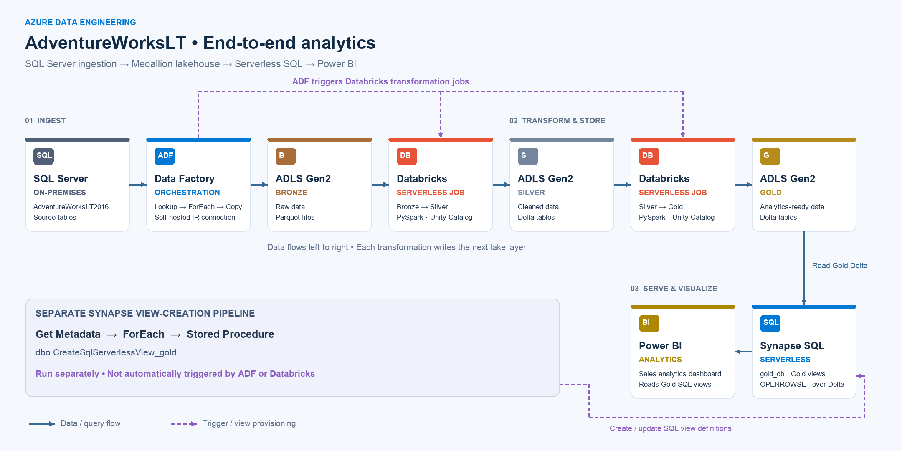
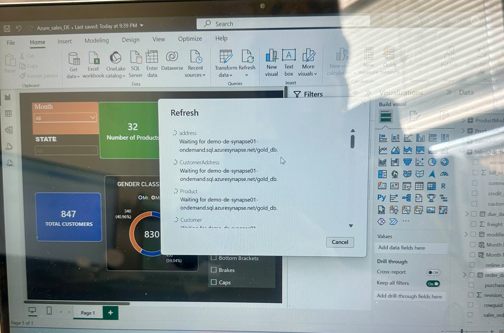

# End-to-End Azure Data Engineering Project

### SQL Server | Azure Data Factory | ADLS Gen2 | Azure Databricks | Azure Synapse Analytics | Power BI

## Project Overview

This project demonstrates an end-to-end Azure Data Engineering solution that ingests data from an on-premises SQL Server database, processes it using a Medallion Architecture, and delivers analytics-ready data to Power BI.

The solution uses Azure Data Factory for data ingestion and orchestration, Azure Data Lake Storage Gen2 for storage, Azure Databricks and PySpark for transformations, and Azure Synapse Analytics Serverless SQL for data consumption.

## Solution Architecture



### Data Flow

1. **SQL Server:** AdventureWorksLT2016 serves as the source database.
2. **Azure Data Factory:** Ingests multiple tables using Lookup, ForEach, and Copy Data activities with a Self-Hosted Integration Runtime.
3. **Bronze Layer:** Stores raw source data in ADLS Gen2 as Parquet files.
4. **Silver Layer:** Databricks performs data cleaning and transformation using PySpark and Delta Lake.
5. **Gold Layer:** Databricks creates analytics-ready Delta datasets.
6. **Azure Synapse Analytics:** Serverless SQL views provide access to Gold data using `OPENROWSET`.
7. **Power BI:** Visualizes the processed data through interactive reports.

## Technology Stack

| Technology | Purpose |
|---|---|
| SQL Server | Source relational database |
| Azure Data Factory | Data ingestion and orchestration |
| Self-Hosted Integration Runtime | Connectivity to on-premises SQL Server |
| Azure Data Lake Storage Gen2 | Bronze, Silver, and Gold storage |
| Azure Databricks | PySpark data transformations |
| Delta Lake | Reliable analytical data storage |
| Unity Catalog | Data governance and access management |
| Azure Synapse Analytics | Serverless SQL querying |
| Power BI | Business intelligence and reporting |
| GitHub | Source control and project documentation |

## Azure Data Factory Pipeline

**Pipeline:** `copyalltables`

The ADF pipeline uses a metadata-driven ingestion pattern:

- Lookup retrieves source table information.
- ForEach iterates through the source tables.
- Copy Data transfers data to ADLS Gen2 Bronze.
- `Run_Medallion_Job` triggers Databricks processing after successful ingestion.

Pipeline definitions and related configuration files are available in the `adf/` folder.

## Databricks Medallion Architecture

### Bronze

Raw SQL Server data is stored in Parquet format, preserving the ingested source records.

### Silver

PySpark notebooks process Bronze data and write cleaned datasets in Delta format.

### Gold

Gold datasets are generated from Silver data and prepared for analytical querying and reporting.

The Databricks workflow `medallion_pipeline_job` contains two dependent tasks:

- `bronze_to_silver`
- `silver_to_gold`

## Azure Synapse Analytics

Azure Synapse Serverless SQL provides SQL access to Gold Delta datasets.

The `gold_db` database contains views created using `OPENROWSET` with `FORMAT = 'DELTA'`.

A separate Synapse pipeline uses Get Metadata, ForEach, and a Stored Procedure activity to create or update Gold SQL views.

Existing views can query updated Gold data without requiring recreation when their definitions and underlying schema remain compatible.

## Power BI Dashboard

The Power BI report connects to Azure Synapse Serverless SQL to visualize AdventureWorksLT sales data.



The report includes interactive analytics and supports refreshing imported data after pipeline processing.

## End-to-End Data Validation

A source-to-report validation test was performed using the `SalesLT.Customer` table.

| Validation | Result |
|---|---|
| Initial source customer count | 847 |
| Test records inserted | 2 |
| Updated source customer count | 849 |
| Source changes visible in Power BI | Verified |

Two test customers were inserted into SQL Server, and their records were successfully verified in Power BI after processing and refresh.

This demonstrates successful propagation of source changes through the data platform.

## Troubleshooting and Lessons Learned

### Databricks Notebook Failure

A notebook execution failed because `silver_df` was referenced before being defined.

**Resolution:** Read the written Silver Delta dataset into a DataFrame before using it for validation.

### ADF Pipeline Execution Status

A manually triggered Databricks Job does not retroactively update the status of an earlier failed ADF pipeline run.

**Lesson learned:** Pipeline execution histories are independent, and end-to-end orchestration should be validated through a new coordinated run.

### Synapse View Validation

SQL validation queries must match the actual schema exposed by the Gold SQL views.

**Lesson learned:** Inspect view schemas before writing column-specific validation queries.

## Repository Structure

```text
azure-end-to-end-data-engineering/
├── README.md
├── architecture/
├── adf/
│   ├── pipelines/
│   ├── datasets/
│   └── linked-services/
├── databricks/
│   ├── bronze/
│   ├── silver/
│   └── gold/
├── synapse/
│   ├── pipelines/
│   └── sql-scripts/
└── powerbi/
    ├── README.md
    └── screenshots/
```

## Future Improvements

- Implement incremental data ingestion
- Add automated data quality checks
- Introduce CI/CD deployment using GitHub Actions
- Improve pipeline monitoring and failure notifications
- Automate Power BI dataset refresh
- Strengthen end-to-end orchestration and recovery

## Conclusion

This project demonstrates practical experience designing, implementing, troubleshooting, and validating an Azure-based data engineering solution from an on-premises relational database to a business intelligence reporting layer.

