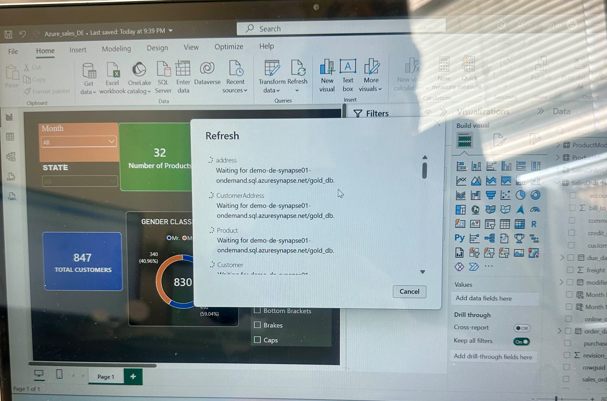

# Power BI — Sales Analytics Dashboard

## Overview

This dashboard visualizes AdventureWorksLT sales data
processed through an Azure Medallion Architecture.

## Data Source

Azure Synapse Analytics Serverless SQL
Database: gold_db
Source: Gold layer SQL views

## Data Pipeline

SQL Server
  → Azure Data Factory
  → ADLS Gen2 (Bronze)
  → Azure Databricks (Silver and Gold)
  → Azure Synapse Serverless SQL
  → Power BI

## Dashboard Features

- Sales and product analytics
- Interactive slicers
- Customer and sales reporting
- Data validation through source-to-report testing

## Data Refresh

Power BI uses imported data from Synapse SQL views.
The report must be refreshed to reflect new Gold data.

## Dashboard Preview

